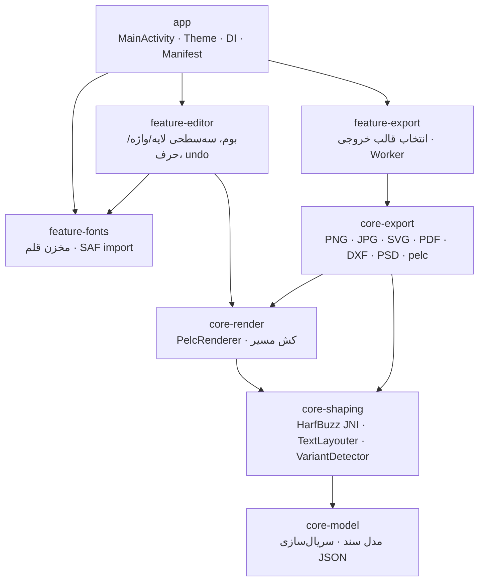
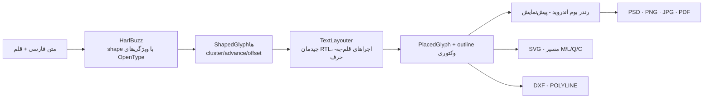

# معماری پلک

پلک یک اپ اندروید بومی (Kotlin + Jetpack Compose + Material 3) است؛ تک‌اکتیویتی، فارسی و راست‌به‌چپ، و کاملاً آفلاین.

## نمودار ماژول‌ها



## جریان شکل‌دهی و رندر



## نکات کلیدی طراحی

1. **مدل سند مستقل از پلتفرم** — `core-model` هیچ نوع گرافیکی اندروید ندارد؛ همهٔ خروجی‌ها از یک مدل واحد تغذیه می‌شوند و خروجی SVG/PDF/DXF از خارج‌کشیده‌شدن مسیرهای واقعی گلیف‌ها (HarfBuzz draw API) فونت‌مستقل است.
2. **شکل‌دهی واقعی با HarfBuzz (NDK)** — پیوند JNI در `core-shaping/src/main/cpp/harfbuzz_jni.cpp`. اعداد در مقیاس ۶۴ برابر تولید می‌شوند و به پیکسل تقسیم می‌شوند تا دقت زیرپیکسلی حفظ شود. برای ایندکس کلاسترها از `MONOTONE_CHARACTERS` استفاده می‌شود تا حرف پایه و اِعراب‌ها یک کلاستر بمانند.
3. **گونه‌های حرف در بستر واقعی** — `VariantDetector` فقط ویژگی‌هایی را پیشنهاد می‌دهد که خروجی شکل‌دهی را واقعاً عوض کنند؛ `TextLayouter` ویژگی را فقط روی بازهٔ کلاستر همان حرف اعمال می‌کند (`FeatureRange`)، پس اتصال حروف همسایه حفظ می‌شود.
4. **قلم-به-حرف** — خط به «اجراهای هم‌قلم» شکسته و هر اجرا جدا شکل‌دهی می‌شود؛ برای RTL اولین اجرای منطقی در سمت راست قرار می‌گیرد. **مفروضه:** اتصال گلیف‌ها روی مرز دو اجرا (دو قلم متفاوت) قطع می‌شود — این ذاتاً به‌دلیل تفاوت دو فایل فونت است.
5. **PSD لایه‌باز بدون کتابخانه** — `PsdWriter` طبق مشخصات Adobe می‌نویسد: هدر، بخش منابع، Layer Records + Channel Data برای هر لایه، نام یونیکد لایه با بلوک `luni` (نام‌های فارسی در فتوشاپ درست دیده می‌شوند) و کامپوزیت نهایی.
6. **DI** — هسته‌ها کلاس‌های سادهٔ Kotlin هستند و گراف Hilt در `app/di` سیم‌کشی می‌شود؛ واکر خروجی با `HiltWorkerFactory` تزریق می‌شود.
7. **واگرد/ازنو** — مدل سند تغییرناپذیر است؛ هر فرمان یک اسنپ‌شات ذخیره می‌کند (سقف ۵۰۰ طبق پذیرش محصول) و کشیدن لایه فقط یک رکورد تاریخ می‌سازد.

## ساختن و تست کردن

```bash
./scripts/fetch-fonts.sh          # دانلود فونت‌های OFL (اختیاری برای فاز ۱)
./gradlew :core-model:test        # تست‌های JVM مدل
./gradlew :core-export:testDebugUnitTest   # تست‌های PSD/SVG/DXF
./gradlew :app:assembleDebug      # APK قابل نصب (شامل بیلد native)
```
